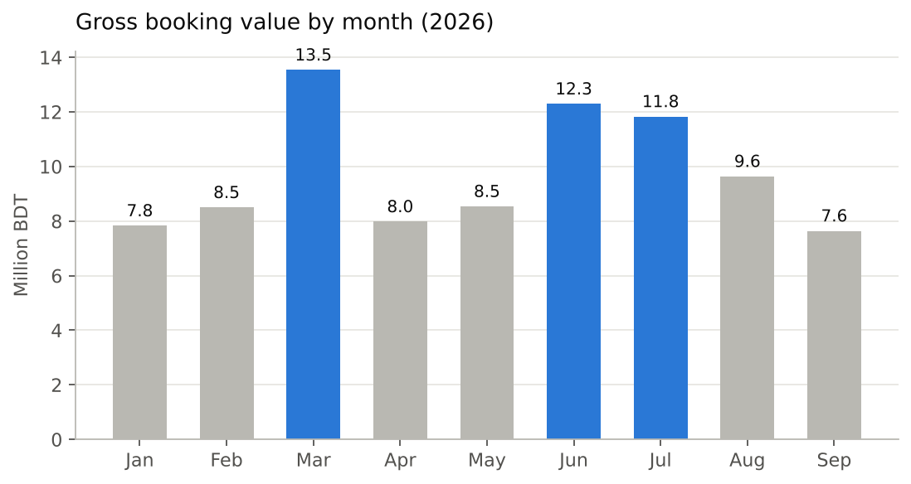
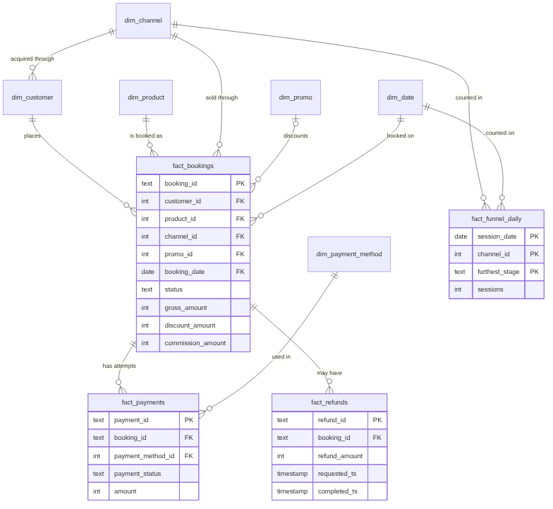
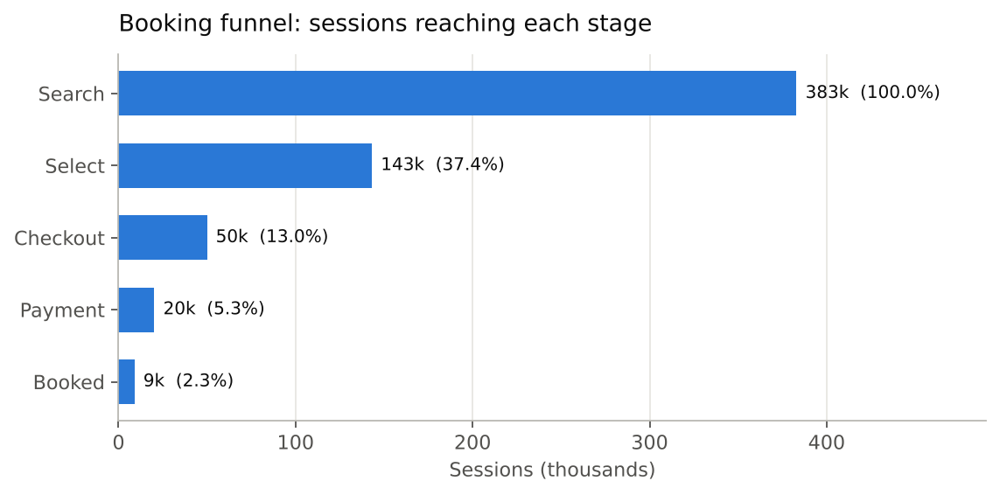
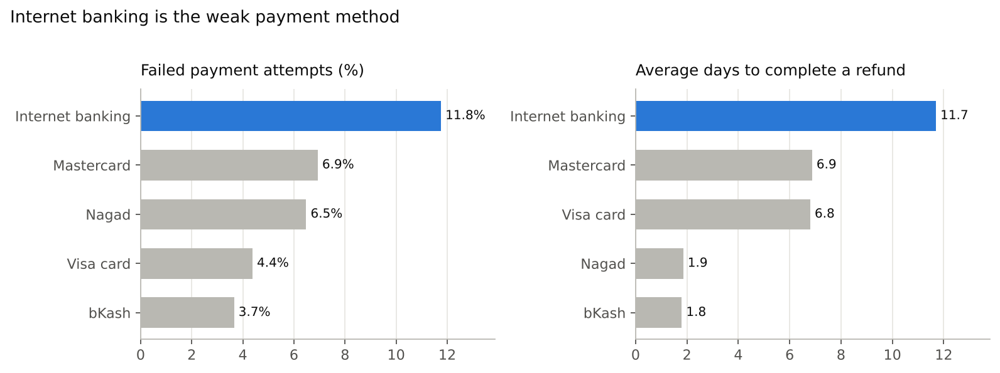
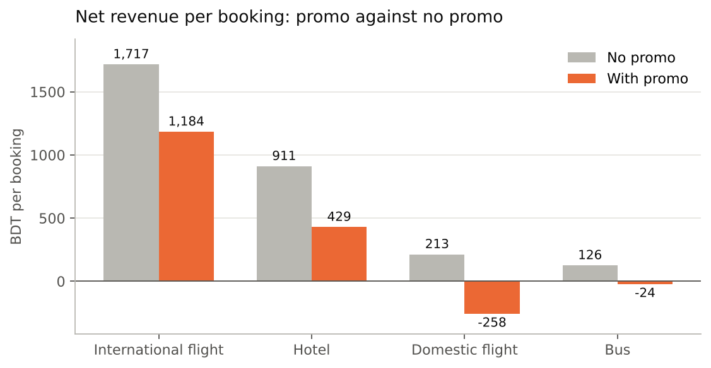

# Travel booking analytics: SQL and Power BI on synthetic data


Messy booking, payment, refund and funnel files for an imaginary online travel marketplace (flights, hotels and buses) go in. A clean dimensional model in PostgreSQL, eight business metrics, a data-quality check suite and four flat files ready for a Power BI dashboard come out.

**The data is synthetic.** A seeded Python script invented every row. No real company, customer or payment data is used, and everything under "What the data shows" describes this invented dataset only.



## The questions

1. How much gross booking value (GBV) do we sell each month?
2. How much of it is net revenue once promo cost is subtracted?
3. Where do visitors drop out between search and booking?
4. Which products and promos see the most cancellations?
5. How long do refunds take, and does it depend on the payment method?
6. Which acquisition channels bring customers who book again?
7. Which booking channels earn the most?
8. What does each promo cost, by payment method?

Exact definitions are in [docs/metric_definitions.md](docs/metric_definitions.md).

## What this project shows

- Cleaning raw exports in SQL: duplicates with `ROW_NUMBER()`, inconsistent text with `LOWER`, `TRIM` and `NULLIF`, and impossible values flagged instead of silently dropped.
- Dimensional modeling: four fact tables sharing six dimensions (a star-style model, or fact constellation), each fact with a stated grain.
- Analysis queries with CTEs, window functions (`LAG`, `FIRST_VALUE`, ranking) and `FILTER`.
- Data-quality checks that reconcile payments to bookings and surface a gap that needs to go to finance.
- A join that double-counts revenue, shown next to the safe version (see "What the data shows").
- Metric definitions written down before the SQL, and a dashboard spec for Power BI.

## Repository layout

```
README.md
run_all.bat / run_all.sh     rebuilds the database in one step (Windows / Linux and macOS)
generator/generate_data.py   the seeded script that invented the data
data/raw/                    9 messy CSV files, as a source system would deliver them
data/powerbi/                4 flat CSV files for the dashboard
sql/                         01 schema, 02 load, 03 clean, 04 checks, 05 metrics,
                             06 analysis questions, 07 views, 08 export
docs/                        setup guide, schema, metric definitions, dashboard spec,
                             charts and the script that draws them
```

## Run it

Full steps for Windows are in [docs/SETUP_WINDOWS.md](docs/SETUP_WINDOWS.md). In short:

1. Install PostgreSQL and DBeaver Community (both free).
2. Run `run_all.bat` (or `./run_all.sh`). It creates a database called `ota`, loads the raw files, cleans them and runs the data-quality checks. It drops any existing database with that name first.
3. Open `sql/05_metrics.sql` and `sql/06_analysis_questions.sql` in DBeaver and run the queries one at a time.
4. Open Power BI Desktop, load the four files in `data/powerbi/`, and build the pages described in [docs/dashboard_spec.md](docs/dashboard_spec.md).

Python is only needed to regenerate the raw files (`python generator/generate_data.py --out data/raw --seed 42`) or the charts (`python docs/make_charts.py`, needs pandas and matplotlib).

## The data model

Fact tables hold events, dimension tables describe them. Four fact tables share the same dimensions, so strictly this is a fact constellation (several stars) rather than a single star. Payments and refunds also link to bookings by booking_id. Each fact table has a stated grain, meaning what one row stands for.

| Table | Grain (one row is...) |
| --- | --- |
| fact_bookings | one booking |
| fact_payments | one payment attempt (a booking can have failed attempts and one success) |
| fact_refunds | one refund request |
| fact_funnel_daily | one day, one channel and one furthest stage reached (a count of sessions) |



More detail in [docs/schema.md](docs/schema.md).

## Messy on purpose

The raw files contain problems that real exports have. Script `03_clean.sql` fixes each one, and `04_data_quality_checks.sql` proves it.

| Problem in the raw files | Count | Fix |
| --- | --- | --- |
| Exact duplicate booking rows | 108 | keep one row per booking_id with ROW_NUMBER() |
| 9 spellings of 3 statuses ("Completed", "COMPLETED ") | 9 | LOWER and TRIM |
| 13 different text values for 4 promo codes (lower case, leading spaces, "NONE"), plus blanks | 13 | UPPER, TRIM and NULLIF, then map to promo_id |
| Internal test bookings with amount 0 | 12 | drop rows where gross_amount is 0 or less |
| Guest checkouts with no customer_id | 34 | keep, but leave out of repeat-customer metrics |
| Refunds that finished before they were requested | 4 | flag with is_timestamp_valid and exclude from refund-time metrics |

After cleaning, the checks find no duplicate bookings, no unmatched promo codes, exactly one successful payment per booking, and amount paid equal to gross minus discount for every booking. They also find 61 cancelled bookings with no refund record, which the data cannot explain. In a real company that gap goes to the finance team.

## What the data shows

The generator plants these patterns on purpose so that there is something to find. They are properties of the invented data, not facts about any real business.







| Finding | Evidence |
| --- | --- |
| Bookings peak in March, June and July | GBV of about 13.5M, 12.3M and 11.8M BDT against 7.6M to 9.6M in other months |
| The EID15 promo goes with more cancellations | 17.5% cancelled (337 bookings) against 8.3% for bookings with no promo |
| Customers acquired through Facebook ads book again about half as often | 14.3% repeat rate against 26.2% to 31.8% for other channels |
| Internet banking is the weak payment method | 11.8% of attempts fail (3.7% to 6.9% for others) and refunds take 11.7 days on average (1.8 to 1.9 days for bKash and Nagad) |
| Promos eat the commission | Bookings with a promo earn 227 BDT net on average against 682 without. Domestic flights lose money overall, with net revenue of about -134,000 BDT |
| A careless join inflates revenue | Joining bookings to every payment attempt overstates GBV by 6.9% (93.9M against 87.8M BDT) |

## Limits

- The data is invented, so none of the findings say anything about a real company.
- GBV and net revenue are defined for this project. Real companies define them in their own ways, so definitions should always be agreed with the business first.
- Repeat rate treats late signups the same as early ones, although late signups have had less time to book again.
- Refund-time averages cover completed refunds only. Refunds still pending at the snapshot date (1 October 2026) are left out.
- The dashboard files and a dashboard spec are provided, but the dashboard itself is not part of this repository until it is built. The Power BI measures in the spec have not been run in Power BI.
- The SQL scripts and `run_all.sh` were run from an empty database to the final results on PostgreSQL 16 on Linux. `run_all.bat` follows the same steps and has not been run on Windows yet.
