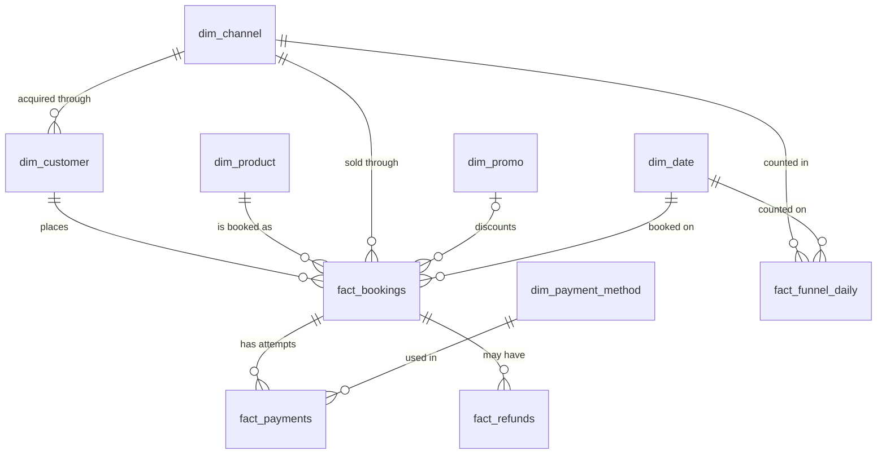

# Schema

## Two layers

The `raw_*` tables hold the files exactly as delivered. They have no keys or checks, so messy rows load without errors. The `dim_*` and `fact_*` tables are the clean analytics layer, with primary keys, foreign keys and checks. `sql/03_clean.sql` moves data from the first layer to the second.

## Reading the diagram

`||--o{` reads "exactly one on the left, zero or many on the right". `|o--o{` for promos reads "zero or one", because most bookings have no promo.

## Tables

| Table | Grain | Primary key | Foreign keys |
| --- | --- | --- | --- |
| dim_customer | one customer | customer_id | acquisition_channel_id to dim_channel |
| dim_product | one flight route, hotel city or bus route | product_id | none |
| dim_channel | one sales channel | channel_id | none |
| dim_promo | one promo code | promo_id | none |
| dim_payment_method | one payment method | payment_method_id | none |
| dim_date | one calendar day | date_key | none |
| fact_bookings | one booking | booking_id | customer_id, product_id, channel_id, promo_id, booking_date |
| fact_payments | one payment attempt | payment_id | booking_id, payment_method_id |
| fact_refunds | one refund request | refund_id | booking_id |
| fact_funnel_daily | one day, channel and furthest stage | session_date, channel_id, furthest_stage | channel_id, session_date |

## Columns that need a sentence

- `fact_bookings.customer_id` is empty for guest checkouts. `promo_id` is empty when no promo was used.
- `gross_amount` is the list price. `discount_amount` is the promo cost the company bears. `commission_amount` is what the company earns from the supplier. The customer pays `gross_amount - discount_amount`.
- `fact_refunds.completed_ts` is empty while a refund is pending. `is_timestamp_valid` is false when the refund finished before it was requested.
- `fact_funnel_daily.sessions` counts sessions. One row is a count, not a single session.

## Why a one-to-many join needs care

One booking has one or more payment attempts. Joining `fact_bookings` to `fact_payments` without a filter repeats a booking once for every attempt, so `SUM(gross_amount)` grows. In this data the error is 6.9% of GBV. Two safe patterns: filter the many-side down to one row per booking (`payment_status = 'success'`), or aggregate the many-side before joining.
